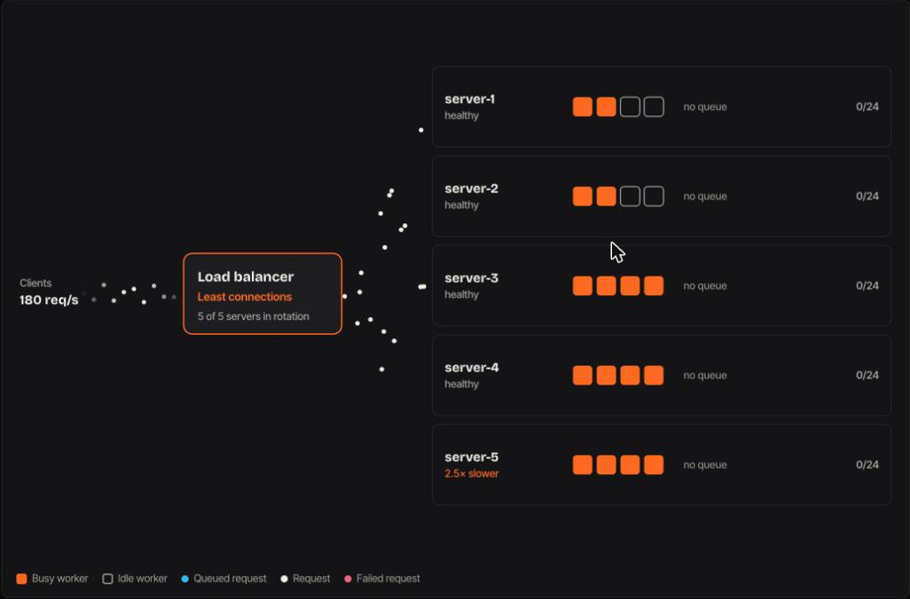

# Load Balancer

A load balancer in front of a pool of servers, simulated in the browser. Switch routing algorithms live and watch where requests go, how queues build, and what each choice does to tail latency.

**Try it:** https://himeshahuja.github.io/load-balancer/



## What you can do

- **Algorithm:** switch between six routing strategies while traffic is flowing.
- **Traffic:** change requests per second.
- **Click a server** to crash it, bring it back, or set its speed, from 4× faster to 5× slower than normal.
- **Add server / Remove:** change the pool, from 2 to 8 servers. Pick each new server's speed (4× faster to 5× slower) and worker count (2, 4 or 8) before adding it.
- **Compare all:** replays the same seeded traffic through every algorithm for 40 simulated seconds and ranks them by latency.

Until you touch anything, a short demo loops. It starts on round robin, switches to least connections, crashes a server and brings it back.

## The algorithms

| Algorithm | How it picks |
| --- | --- |
| Round robin | Each server in turn |
| Random | Uniformly at random |
| Least connections | Fewest requests in flight |
| Power of two choices | The less busy of two random servers |
| Least response time | Lowest recent latency (EWMA), weighted by requests in flight |
| Consistent hashing | Each client always maps to the same server on a hash ring (40 virtual nodes per server) |

With five servers, one of them 2.5× slower, at 180 requests per second:

| Algorithm | p50 | p99 | Failed |
| --- | --- | --- | --- |
| Round robin | 80 ms | 1,264 ms | 5.5% |
| Random | 84 ms | 1,187 ms | 5.5% |
| Least connections | 79 ms | 294 ms | 0% |
| Power of two choices | 79 ms | 319 ms | 0% |
| Least response time | 77 ms | 236 ms | 0% |
| Consistent hashing | 406 ms | 1,202 ms | 26% |

Round robin and random keep sending the slow server its full share until its queue overflows. The adaptive algorithms see it holding requests longer and route around it. Consistent hashing keeps clients sticky, which is great for caches, but its busiest clients overload their server.

## The model

A discrete-event simulation in virtual milliseconds (`js/sim.js`):

- **Arrivals:** Poisson, from 40 clients with uneven activity.
- **Network:** 10 ms each way between the balancer and a server.
- **Servers:** 4 workers and 24 queue slots each. Service times are lognormal around 60 ms, scaled by the server's speed. A full queue answers 503.
- **Failures:** a crashed server loses its queued and in-flight requests. The balancer only finds out by timing out after 600 ms, until two failed health checks (500 ms apart) take the server out of rotation. One passing check puts it back.

## Checked

`node tests/check.mjs` runs:

- 120 chaotic runs: every algorithm through random crashes, recoveries, slowdowns, pool changes and traffic swings, 1.3 million requests in all. It checks that every routed request ends exactly once, that workers and queues never exceed their limits, that in-flight counts never go negative, and that nothing is ever routed to a server marked unhealthy.
- Consistent hashing never moving a client while the pool is stable.
- The adaptive algorithms beating round robin's p99 when one server is slow.

All pass.

No build step. To run locally:

```sh
python3 -m http.server 8000
```
